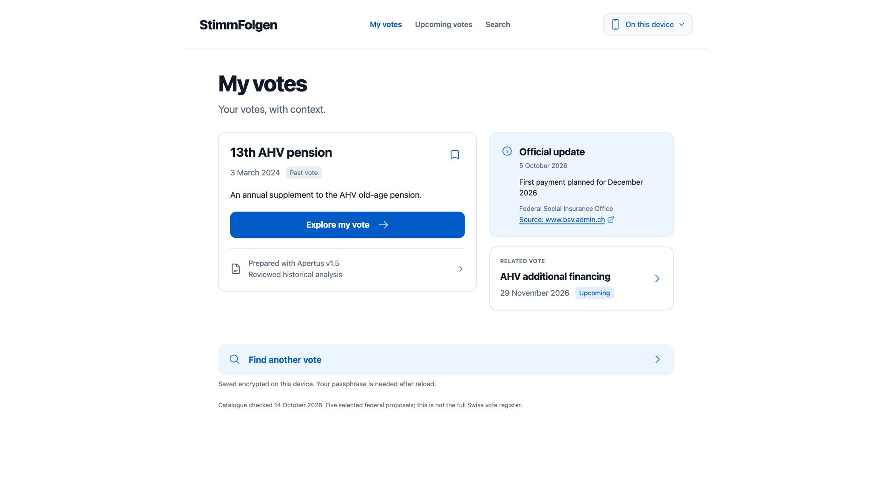

# StimmFolgen

**Follow a Swiss vote, understand its dated evidence, and keep your own reflections private.**

Hack Apertus 2026 · Track 2B · On-premise prototype. My votes, Upcoming votes and Search lead to a short explanation, original sources, later official updates, related votes and perspectives for Me, Others and Switzerland. No voting recommendation or inferred Yes/No choice.



[Actual mobile view](track_2b/docs/evidence/tracker-v2-2026-10-14/mobile-final.png). Screenshots show synthetic tracking, not the owner’s political choices.

## Try live Apertus - no download

[Open StimmFolgen](https://stimmfolgen-demo.stimmfolgen-hosted.workers.dev/). Search AHV, track it, and ask a public question. Real Public AI Apertus v1.5 8B interprets the question; retrieval and directness checks select unchanged, reviewed source wording. The question match is AI-produced and not human reviewed. Other catalogue votes have official references but no reviewed AI explanation.

This is a **finite free demo**: 200 shared questions total, at most 80/day, with a seven-day API credential. No payment method, paid plan or automatic top-up was added. Cloudflare hosts the site globally; questions go to Public AI. This demonstration is **not Swiss-sovereign hosting**. The Mac is never exposed to visitors. [Proof, failures and limits](track_2b/docs/evidence/hosted-local-2026-10-15/REVIEW.md).

[Watch the 119.5-second participant-audio revision](https://stimmfolgen-demo.stimmfolgen-hosted.workers.dev/demo) - existing actual app captures with recorded participant audio and synthetic demonstration notes. This voice-only update was published after the 16 October noon CEST deadline; organiser acceptance is not established. The page links the unchanged original submitted 115-second synthetic-narration cut.

## Run local Apertus on your own Mac

Tested from a fresh public clone on Apple Silicon M3 Pro, 18 GiB. Python 3.11+, Docker Desktop and disk for the 4.53 GB weights, runtime and Docker images. Setup needs internet; inference needs no API key.

```sh
make local-download
make run ONPREM=1 APP_PORT=8784
```

Already have the pinned model? Use `make onprem-setup MODEL_DIR=/path/to/model`, then pass the same MODEL_DIR to run. Open http://127.0.0.1:8784/. Native MLX uses the Mac GPU; a non-root read-only Docker app reaches it through Docker Desktop. The launcher binds services to loopback, verifies weights and source, and stops only its own processes. [Local instructions and exact evidence](track_2b/docs/JUDGE_RUN.md).

## Run the reviewed Docker case

With Docker and make installed, from a clean checkout:

```sh
make run
```

Open http://127.0.0.1:8770. Use `make run PORT=8772` if that port is occupied. The build fetches dependencies and the hash-pinned official booklet; a mismatch fails closed. No credentials, model weights or paid API are needed for the reviewed publication journey. The container runs as a non-root user with a read-only filesystem and loopback-only host binding.

## A 90-second judge journey

1. Search AHV and track **13th AHV pension**. Return to My votes, then Explore my vote.
2. Read What it means; open Source and dates for original passages, actor, page and historical frame.
3. Open Perspectives. A working-age person gets an honest unknown personal charge, not a fabricated CHF calculation.
4. Inspect separately dated official updates and the related financing proposal.
5. Add a **synthetic** private note. Keep it only for this visit or create an optional encrypted local vault. Reload locks saved data; encrypted backup/recovery stays local.

## Where Apertus is used

Actual local Apertus v1.5 8B inference selected immutable source spans, extracted candidate values and identified attribution. Independent controls and five accepted source statements produced the published AHV explanation. Seven bounded trials passed using eight real model completions. Earlier failures are retained.

The overview serves **reviewed recorded results**. On configured installations, Ask Apertus performs a real API request using only the explicit public question and reviewed AHV evidence; it never attaches private choices or notes. Default Docker publication works without an LLM endpoint. P03 is reviewed reference context, not an extraction from the final trial. The other four selected proposals have official references but no reviewed Apertus explanation. Catalogue search, update metadata and encryption are application functions.

```text
Official booklet -> immutable spans -> local Apertus candidates
                 -> independent checks + human review -> reviewed public case
Browser -> reviewed publication API -> explanation, citations and updates
Explicit public question -> local or hosted Apertus -> separate same-model check
                        -> unreviewed answer with immutable source references
Browser-only choices/notes -> optional encrypted vault and encrypted backup
```

Native inference uses the pinned community text-only MLX 4-bit conversion of swiss-ai/Apertus-v1.5-8B on Apple Silicon. Linux Docker runs publication/evidence replay, not Mac GPU inference. [Judge instructions](track_2b/docs/JUDGE_RUN.md) provide the separate native reproduction commands.

## Verify and review

```sh
make check
python -m unittest discover -s track_2b/tests -p 'test*.py'
node track_2b/tests/test_private_vault.mjs
```

Python tests require PyMuPDF 1.28.2; vault tests require Node 22+. Docker `make check` uses its pinned environment. The synthetic blueprint validator is separate from real-model evidence.

- [Current technical report](track_2b/StimmFolgen_Report.pdf) · [editable source](track_2b/technical_report.md)
- [Historical 98-second reviewed-case demo](track_2b/demo/StimmFolgen_Tracker_Demo.mp4) · [transcript](track_2b/demo/TRACKER_DEMO.md) · [captions](track_2b/demo/StimmFolgen_Tracker_Demo.srt)
- [Submission preparation and remaining owner actions](track_2b/docs/SUBMISSION_READINESS.md)
- [Exact judge run](track_2b/docs/JUDGE_RUN.md) · [API contract](track_2b/docs/APP_CONTRACT.md)
- [Real Apertus release evidence](track_2b/docs/evidence/APP_RELEASE_2026-10-14.md) · [tracker evidence](track_2b/docs/evidence/tracker-v2-2026-10-14/REVIEW.md)
- [Privacy limits](track_2b/docs/PRIVATE_TRACKER_THREAT_MODEL.md) · [third-party rights review](THIRD_PARTY_NOTICES.md)
- [Official Track 2B instructions](track_2b/README.md) · [historical design blueprint](track_2b/docs/blueprint-v0.1/README.md)

## Scope and limits

One reviewed historical AHV development case and six selected proposals, not a complete registry. A second real booklet case has source-bound candidates and actual model/browser tests, but human wording acceptance is pending; only official information is public. No unseen-ballot accuracy proof, current-law personal calculator, comprehension study, exhaustive accessibility audit, account/sync or independent security audit. Encryption protects stored ciphertext, not an unlocked/compromised device. A lost passphrase cannot be recovered. External official-source visits remain visible to their publishers.

The required submission is through the organisers' website, not Devpost. A prepared video/PDF or passing CI does not mean the project has been submitted. The older reader demo and evidence remain historical artifacts.

## Live evidence and limits (15 October 2026)

[Earlier hosted/local delivery proof](track_2b/docs/evidence/hosted-local-2026-10-15/REVIEW.md) records actual public inference with the local model/app stopped, the responsive browser journey, fresh native runtime setup and retained failures. That earlier five-question direct v5 diagnostic had one supported answer, one abstention and three withheld results; those failures remain. Live semantic quality is experimental; this does not expand the human-reviewed Gate to arbitrary questions.

[Earlier local development evidence](track_2b/docs/evidence/live-apertus-2026-10-15/REVIEW.md) preserves all 20 local trials. The Mac remains private. [Hosting boundaries](track_2b/docs/LIVE_HOSTING.md) distinguish this finite global demo from optional local and paid Swiss routes. The current five-page report and 115-second live walkthrough describe the deployed service; no organiser submission or main merge is implied.


## Current two-vote and installation proof

[Fresh-clone on-premise and two-case evidence](track_2b/docs/evidence/onprem-2026-10-15/REVIEW.md): 20/20 local known questions (16 invoke real Apertus; four explicit application refusals), 45/45 hosted known questions, 108 Python tests and 29 compiled Worker tests. New runtime and no-cache app builds reused verified downloaded weights on the same Mac; no new remote model download or second machine is claimed. Both candidate journeys were tested in a private labelled mobile/desktop preview, and the public release was checked through an isolated test origin using the production model service. This is agent-operated testing, not an independent user study or held-out benchmark.

[Homeownership reform wording review](track_2b/docs/evidence/property-tax-2026-10-15/REVIEW.md) is the remaining second-analysis publication gate. Technical diagnostics are separate from ordinary reading screens. The current five-page report records these limits; video files are unchanged by this continuation.
